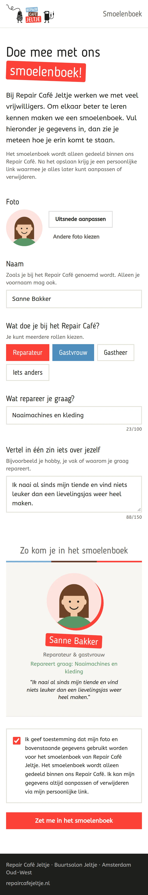
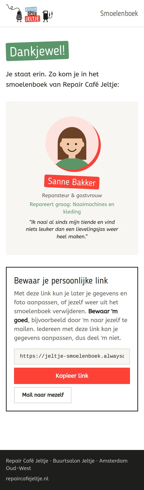
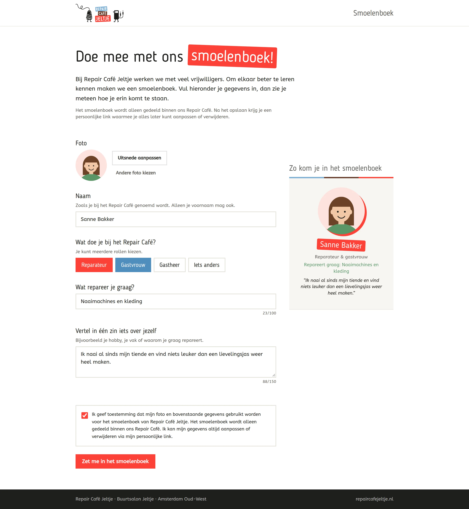
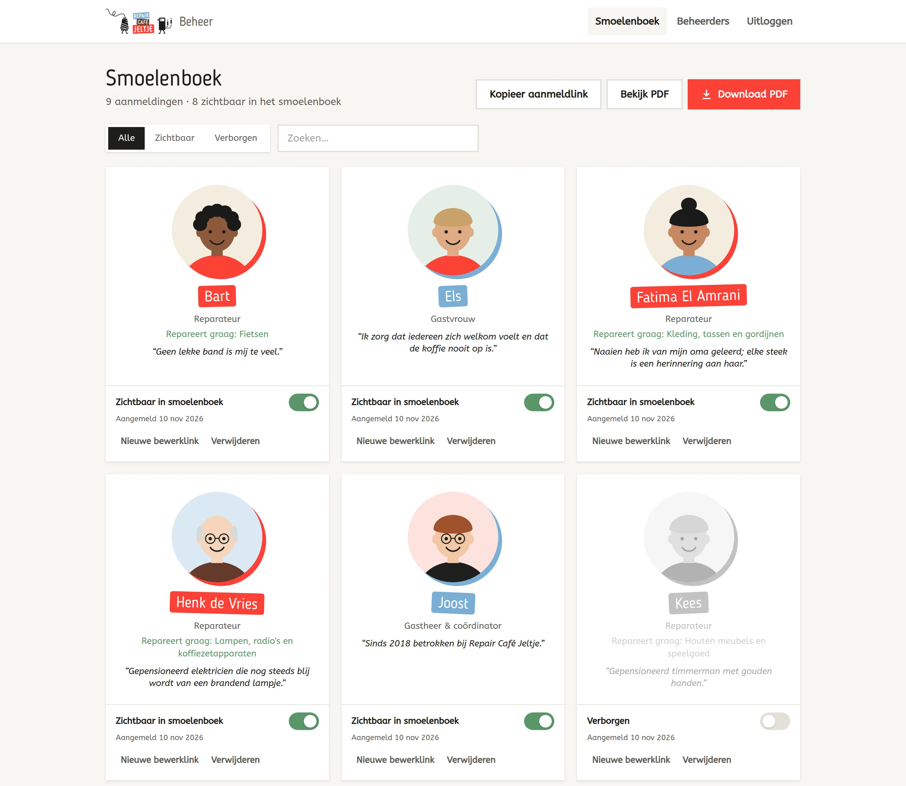
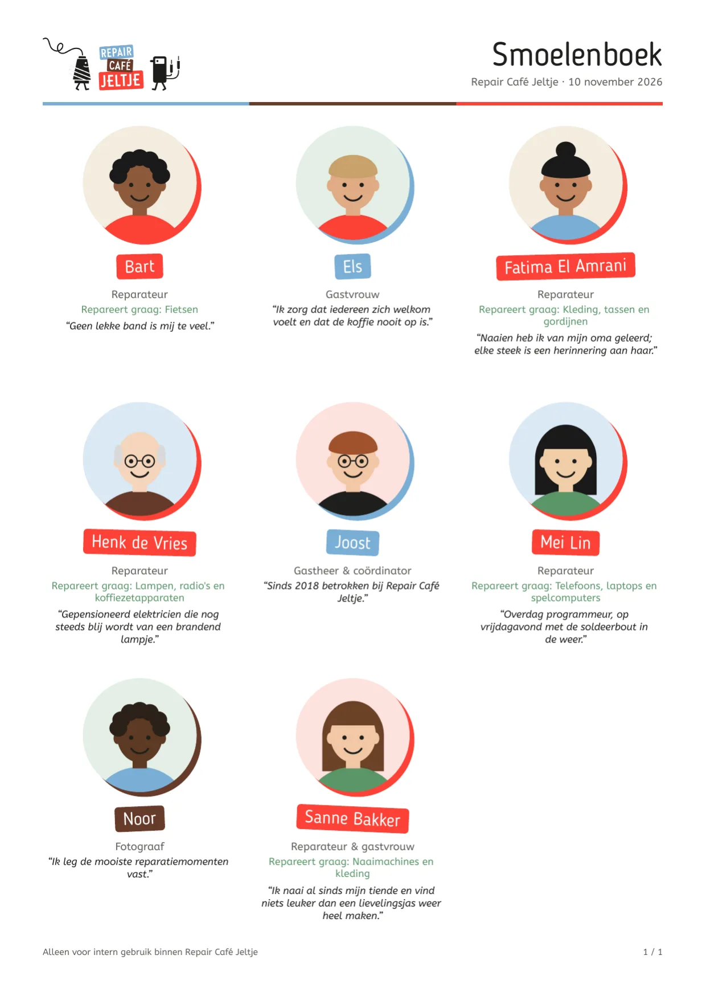
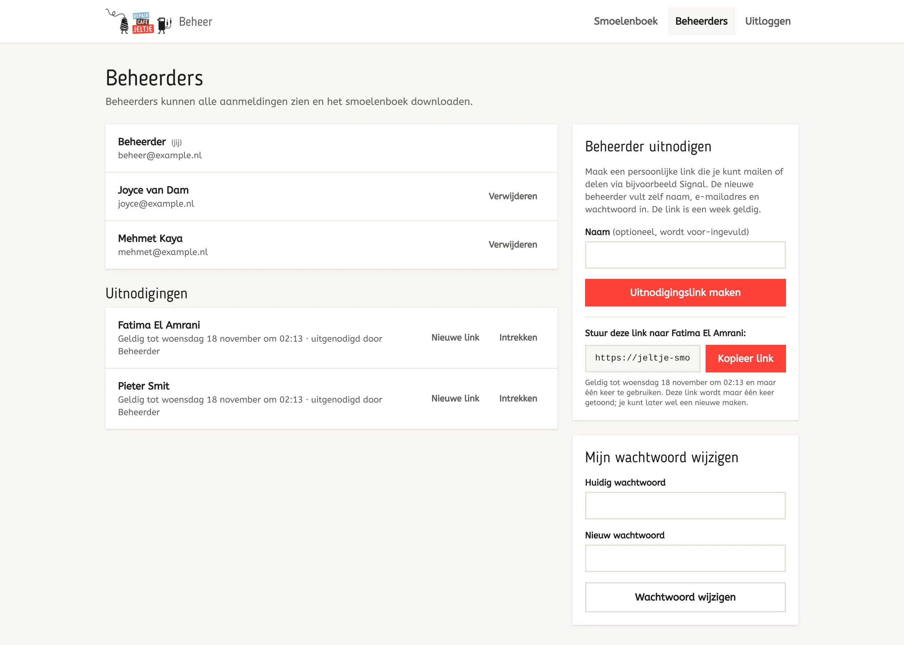
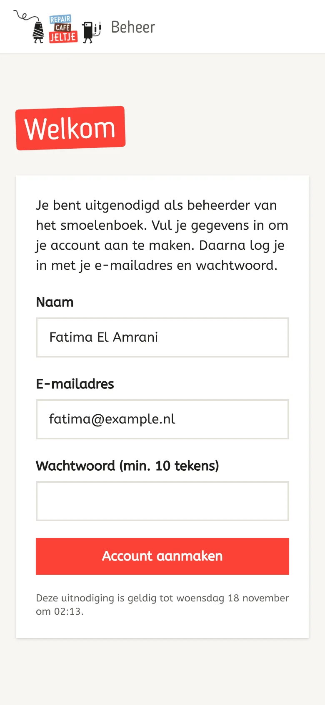

# Smoelenboek Repair Café Jeltje

Een kleine webapp waarmee vrijwilligers van Repair Café Jeltje zichzelf aanmelden voor het
smoelenboek, en waarmee beheerders het smoelenboek als PDF downloaden.

**Voor vrijwilligers (openbaar, mobielvriendelijk)**

- Foto uploaden, uitsnijden, verschuiven, zoomen en draaien (ronde uitsnede)
- Naam, rol(len) (reparateur / gastvrouw / gastheer / iets anders), wat je graag repareert en
  één zin over jezelf (max. 150 tekens)
- Live voorbeeld van hoe je in het smoelenboek komt
- Toestemmingsvinkje (verplicht)
- Na het opslaan krijg je een persoonlijke, geheime bewerklink waarmee je je gegevens aanpast of
  jezelf verwijdert. Een eerder gekozen uitsnede kun je later nog aanpassen.

<table>
  <tr>
    <td width="33%"></td>
    <td width="33%"></td>
    <td width="33%"></td>
  </tr>
</table>

**Voor beheerders (`/beheer`, met persoonlijke login)**

- Overzicht van alle aanmeldingen, zoeken en filteren
- Per persoon de zichtbaarheid in het smoelenboek aan/uit zetten
- Nieuwe bewerklink maken voor iemand die de eigen link kwijt is (de oude link vervalt)
- Personen verwijderen
- **Download PDF**: het smoelenboek in A4-formaat, 9 personen per pagina, alleen zichtbare personen
- Beheerders uitnodigen via een persoonlijke link (te mailen of te delen via bijv. Signal), een
  week geldig en maar één keer te gebruiken; de nieuwe beheerder vult zelf naam, e-mailadres en
  wachtwoord in. Overzicht van openstaande uitnodigingen, met nieuwe link maken of intrekken.
- Beheerders verwijderen en eigen wachtwoord wijzigen

<table>
  <tr>
    <td width="60%"></td>
    <td width="40%"></td>
  </tr>
</table>

<table>
  <tr>
    <td width="70%"></td>
    <td width="30%"></td>
  </tr>
</table>

De voorbeeldpersonen in de screenshots zijn verzonnen en hebben getekende avatars.

## Techniek

- [Nuxt 4](https://nuxt.com) met [Vite+](https://viteplus.dev) en Tailwind CSS 4
- Opslag: één SQLite-bestand via de ingebouwde `node:sqlite` van Node.js (geen native modules),
  inclusief de foto's. Backup = dat ene bestand kopiëren.
- Beheerderssessies met [nuxt-auth-utils](https://github.com/atinux/nuxt-auth-utils), wachtwoorden
  gehasht met scrypt.
- Bewerklinks en uitnodigingslinks: willekeurig token van 192 bits; in de database staat alleen de
  SHA-256-hash.
- PDF wordt op de server gemaakt met [PDFKit](https://pdfkit.org), met de huisstijlfonts Blogger
  Sans en ABeeZee.
- Foto's worden in de browser verkleind en uitgesneden (vierkant, 800 px). Het verkleinde origineel
  (max. 1600 px) wordt bewaard zodat iemand de uitsnede later kan aanpassen.
- Privacy: geen externe requests (fonts staan lokaal), `noindex`, `no-referrer`, foto's en gegevens
  alleen bereikbaar via de bewerklink of als beheerder.

## Ontwikkelen

Vereist Node.js 22.18 of nieuwer (24 LTS aanbevolen).

```bash
vp install
node scripts/admin.ts add jij@example.nl "Je naam"   # eerste beheerder aanmaken
vp run dev                                           # http://localhost:3000
vp check                                             # format, lint en types
vp run typecheck                                     # types in .vue-bestanden
vp run screenshots                                   # screenshots in de README bijwerken
```

`vp run screenshots` bouwt de app en start die met een tijdelijke database vol voorbeelddata
(je eigen database blijft onaangeroerd), en gebruikt Google Chrome (`CHROME=...` voor een ander
pad) en `pdftoppm` (pakket poppler-utils) voor de PDF-afbeelding.

| Pagina                 | Wat                                  |
| ---------------------- | ------------------------------------ |
| `/`                    | Aanmeldformulier                     |
| `/bewerken/<token>`    | Eigen gegevens aanpassen             |
| `/beheer`              | Beheer (login vereist)               |
| `/beheer/beheerders`   | Beheerders beheren                   |
| `/uitnodiging/<token>` | Uitnodiging als beheerder accepteren |

### Beheerders via de commandline

```bash
node scripts/admin.ts add <email> [naam]   # vraagt om een wachtwoord (min. 10 tekens)
node scripts/admin.ts password <email>
node scripts/admin.ts remove <email>
node scripts/admin.ts list
```

Het script gebruikt `NUXT_DATA_DIR` om de database te vinden (standaard `.data`).

## Configuratie

| Variabele         | Betekenis                                                          |
| ----------------- | ------------------------------------------------------------------ |
| `NUXT_APP_SECRET` | Verplicht in productie. Min. 32 tekens: `openssl rand -base64 32`. |
| `NUXT_DATA_DIR`   | Map voor de SQLite-database. Standaard `.data`.                    |
| `IP` / `PORT`     | Adres en poort om op te luisteren (Alwaysdata zet deze zelf).      |

## Hosten op Alwaysdata

1. **Node.js-versie**: kies onder _Environment → Node.js_ versie 24 (of nieuwer).
2. **Bouwen en uploaden** vanaf je eigen computer. Er wordt niets geïnstalleerd of gebouwd op de
   server (daar is te weinig ruimte/geheugen voor); alleen de build (~6 MB) gaat erheen. Stel eerst
   een ssh-host in (bijv. `smoelenboek` in `~/.ssh/config`), dan:

   ```bash
   vp run deploy   # of: DEPLOY_HOST=... DEPLOY_DIR=... vp run deploy
   ```

   Eenmalig op de server de datamap en de eerste beheerder aanmaken:

   ```bash
   ssh smoelenboek
   mkdir -p ~/smoelenboek-data
   NUXT_DATA_DIR=~/smoelenboek-data node smoelenboek/scripts/admin.ts add jij@example.nl "Je naam"
   ```

3. **Site aanmaken** onder _Web → Sites → Add a site_:
   - _Addresses_: bijv. `smoelenboek.repaircafejeltje.nl` (of een `*.alwaysdata.net`-adres)
   - _Type_: **Node.js**
   - _Command_: `node server.mjs`
   - _Working directory_: `smoelenboek`
   - _Environment_:
     ```
     NUXT_APP_SECRET=<uitkomst van openssl rand -base64 32>
     NUXT_DATA_DIR=/home/<account>/smoelenboek-data   # volledig pad
     ```
   - Zet onder _SSL_ "Force HTTPS" aan.

   Alwaysdata geeft `IP` en `PORT` zelf mee; `server.mjs` zorgt dat de app daarop luistert.

4. **Updaten**: gaat automatisch bij elke push naar `main` (zie hieronder). Handmatig kan ook met
   `vp run deploy`; zet `ALWAYSDATA_API_TOKEN` om de site daarna automatisch te herstarten, anders
   herstart je hem in het Alwaysdata-panel.

### Automatisch deployen met GitHub Actions

[.github/workflows/ci.yml](.github/workflows/ci.yml) controleert elke pull request: `vp check`
(format, lint en types), `vp run typecheck` (types in `.vue`-bestanden) en de build.

[.github/workflows/deploy.yml](.github/workflows/deploy.yml) draait bij elke push naar `main`: eerst
dezelfde controles uit `ci.yml`, dan bouwen, uploaden via SSH en de site herstarten via de
Alwaysdata API. Faalt een controle, dan wordt er niets gedeployed. Je kunt de workflow ook met de hand starten
onder _Actions → Deploy → Run workflow_.

Eenmalig instellen:

1. **Deploy-sleutel**: maak een aparte SSH-sleutel zonder wachtwoord, alleen voor GitHub:
   `ssh-keygen -t ed25519 -N "" -C github-actions-smoelenboek -f deploy_key`.
   Zet `deploy_key.pub` bij Alwaysdata onder _Remote access → SSH/SFTP_ bij je SSH-gebruiker.
2. **API-token**: maak in het Alwaysdata-panel een token aan onder _Customer area → Profile →
   Tokens_ (beperk het tot dit account als dat kan).
3. **GitHub secrets** (_Settings → Secrets and variables → Actions_), of met de `gh` CLI:
   ```bash
   gh secret set DEPLOY_SSH_KEY < deploy_key
   gh secret set ALWAYSDATA_API_TOKEN
   ```
   Verwijder daarna de lokale `deploy_key`-bestanden.

Wisselt de server ooit van host key, pas dan `SSH_KNOWN_HOST` in de workflow aan.

**Backup**: Alwaysdata maakt dagelijks backups van je home-map, dus ook van
`~/smoelenboek-data/smoelenboek.sqlite`. Een losse kopie maken kan veilig met
`sqlite3 smoelenboek.sqlite ".backup kopie.sqlite"`.

De database houdt de data buiten de code-map, zodat een nieuwe deploy nooit gegevens overschrijft.
